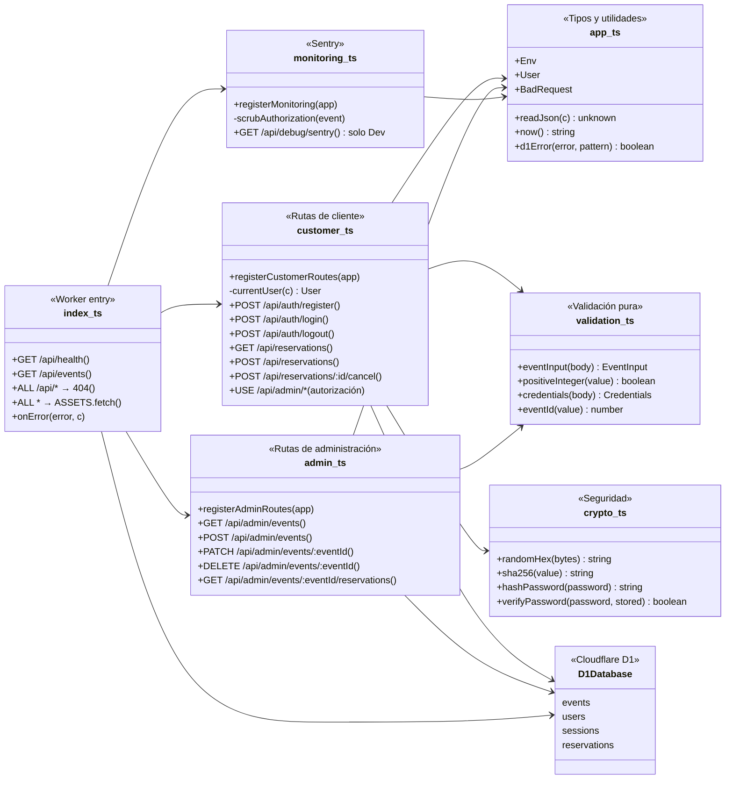
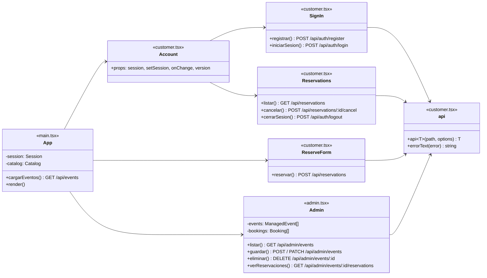
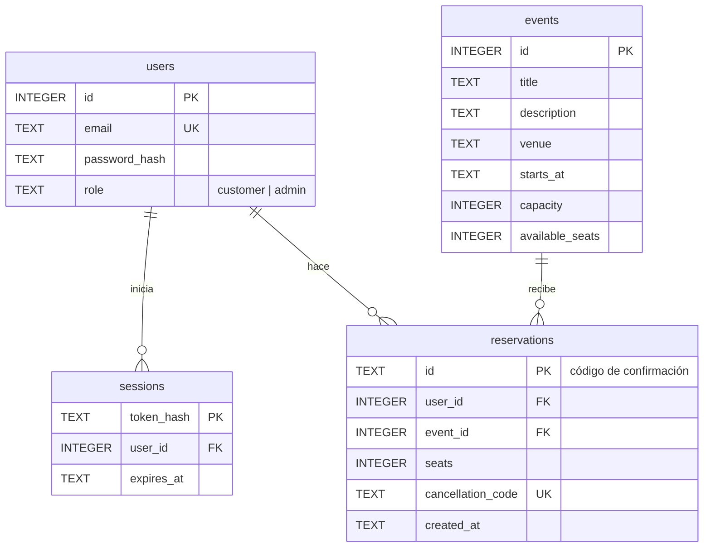
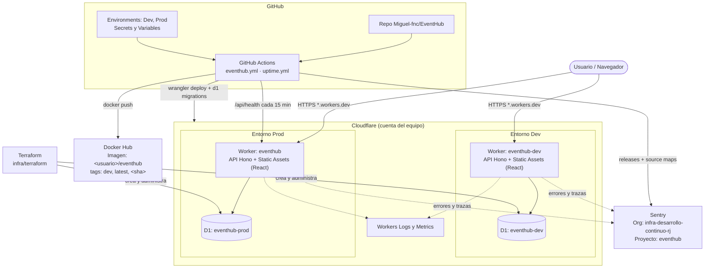
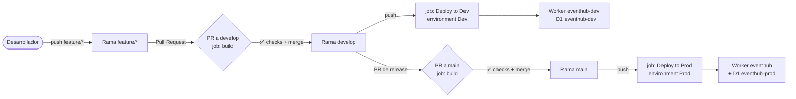
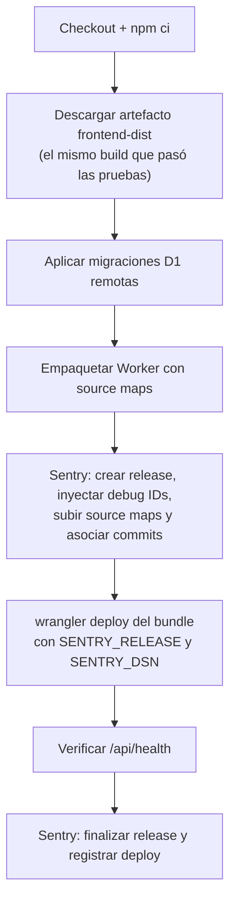

# EventHub

## 1. Descripción del proyecto

**EventHub** es un sistema web de reservaciones de eventos.

- **Clientes:** consultan el catálogo de próximos eventos, crean su cuenta, inician sesión, reservan lugares y cancelan sus reservaciones. Cada reservación genera un código de confirmación y cada cancelación un código de cancelación.
- **Administradores:** publican, editan y eliminan eventos, ajustan el cupo y consultan las reservaciones activas y canceladas de cada evento.

Reglas de negocio principales:

- Una reservación activa por cliente y evento.
- No se puede reservar un evento que ya comenzó ni sin lugares suficientes.
- El cupo de un evento nunca puede ser menor que los lugares ya reservados.
- Solo se pueden eliminar eventos sin reservaciones activas; sus reservaciones canceladas se borran junto con el evento.
- Las sesiones duran 8 horas.

| Entorno | Rama | URL |
|---|---|---|
| Dev | `develop` | https://eventhub-dev.miguelfnco2.workers.dev |
| Prod | `main` | https://eventhub.miguelfnco2.workers.dev |

Repositorio: https://github.com/Miguel-fnc/EventHub (fork de `rencaballero/EventHub`, donde corre el despliegue continuo).

---

## 2. Stack tecnológico

| Capa | Tecnología | Uso |
|---|---|---|
| Frontend | React 19 + TypeScript + Vite 7 | Interfaz SPA (catálogo, cuenta, reservaciones, panel de administración) |
| Backend | Cloudflare Workers + Hono 4 + TypeScript | API REST en `/api/*` |
| Base de datos | Cloudflare D1 (SQLite administrado) | Eventos, usuarios, sesiones y reservaciones |
| Hosting del frontend | Workers Static Assets | Sirve `frontend/dist` desde el mismo Worker y dominio |
| Seguridad | WebCrypto (PBKDF2-SHA256, 100 000 iteraciones; tokens SHA-256) | Hash de contraseñas y sesiones |
| CI/CD | GitHub Actions | Pruebas, build, despliegue a Dev y Prod, monitoreo de disponibilidad |
| Herramienta de despliegue | Wrangler 4 (CLI de Cloudflare) | Migraciones de D1, empaquetado y despliegue |
| Infraestructura como código | Terraform 1.6+ con el proveedor `cloudflare/cloudflare` v5 | Creación y administración de las bases D1 |
| Contenedores | Docker + Docker Hub | Imagen portable `eventhub` (API + frontend + D1 local) |
| Observabilidad | Sentry (`@sentry/hono`, `@sentry/cloudflare`) + Workers Logs | Errores, trazas, releases y logs |
| Pruebas | `node:test` (unitarias) + `infra/smoke.mjs` (integración) | Validaciones y flujo completo cliente/admin |
| Runtime local | Node.js 24, Wrangler dev (Miniflare) | Desarrollo sin cuenta de Cloudflare |

---

## 3. Componentes y métodos (diagrama de clases)

### 3.1 Backend (`backend/src`)



### 3.2 Frontend (`frontend/src`)



### 3.3 Modelo de datos (D1)



Las migraciones viven en `backend/migrations` (`0001_events.sql`, `0002_reservations.sql`) y el pipeline las aplica antes de cada despliegue.

---

## 4. Recursos que se crean (diagrama de infraestructura)



| Recurso | Nombre | Entorno | Cómo se crea |
|---|---|---|---|
| Cloudflare Worker | `eventhub-dev` | Dev | `wrangler deploy --env dev` (pipeline) |
| Cloudflare Worker | `eventhub` | Prod | `wrangler deploy` (pipeline) |
| Base de datos D1 | `eventhub-dev` | Dev | Terraform (`cloudflare_d1_database.eventhub["dev"]`) |
| Base de datos D1 | `eventhub-prod` | Prod | Terraform (`cloudflare_d1_database.eventhub["prod"]`) |
| Imagen Docker | `<usuario>/eventhub` | `dev` / `latest` | Pipeline, job `docker` |
| Static Assets | `frontend/dist` | Dev y Prod | Se sube junto con cada Worker |
| Subdominio | `miguelfnco2.workers.dev` | Dev y Prod | Cuenta de Cloudflare |
| API Token | Edit Cloudflare Workers + D1 Edit | CI | Dashboard de Cloudflare |
| Proyecto Sentry | `eventhub` | Dev y Prod (`environment`) | Sentry |
| GitHub Environments | `Dev`, `Prod` | — | Settings del repo |

La configuración de los Workers (bindings, entornos y variables) está como código en `backend/wrangler.jsonc`.

### 4.1 Infraestructura como código (Terraform)

Código en [`infra/terraform`](../tree/develop/infra/terraform):

| Archivo | Contenido |
|---|---|
| `versions.tf` | Terraform ≥ 1.6 y proveedor `cloudflare/cloudflare` ~> 5.0. El token se lee de `CLOUDFLARE_API_TOKEN`. |
| `variables.tf` | `account_id` (validado), `project` (`eventhub`), `environments` (`dev`, `prod`) |
| `main.tf` | `cloudflare_d1_database.eventhub` con `for_each` por entorno, `prevent_destroy` para proteger los datos |
| `imports.tf` | Adopta las bases que ya existían, sin recrearlas |
| `outputs.tf` | `d1_database_ids` y `d1_database_names`, que van en `wrangler.jsonc` |
| `terraform.tfvars.example` | Valores de ejemplo |

```hcl
resource "cloudflare_d1_database" "eventhub" {
  for_each   = var.environments
  account_id = var.account_id
  name       = "${var.project}-${each.key}"

  read_replication = {
    mode = "disabled"
  }

  lifecycle {
    prevent_destroy = true
    ignore_changes  = [primary_location_hint, jurisdiction]
  }
}
```

Flujo: `terraform init` → `terraform plan` → `terraform apply` → `terraform output d1_database_ids`. El workflow `terraform.yml` ejecuta `fmt -check`, `init` y `validate` en cada PR que toca la infraestructura.

División de responsabilidades: **Terraform** administra los recursos persistentes (bases D1); **Wrangler** (desde GitHub Actions) despliega el código de los Workers y aplica las migraciones de esquema.

---

## 5. Diagrama de deployment



Pasos de cada despliegue (job `deploy`):



---

## 6. Estrategia de ramas y Pull Requests

- `main`: versión estable. Solo recibe PRs desde `develop` (release) o `hotfix/*`. Cada merge despliega a **Prod**.
- `develop`: integración de la siguiente versión. Rama por defecto del repo. Cada merge despliega a **Dev**.
- `feature/<issue>-<nombre>`: sale de `develop` y vuelve a `develop` por PR.
- `fix/<nombre>`: corrección no urgente; sale de `develop` y vuelve por PR.
- `hotfix/<nombre>`: corrección urgente; sale de `main`, entra a `main` y después a `develop`.

Protección (Rulesets): `main` y `develop` exigen Pull Request, bloquean force push y borrado, y requieren que el check `build` pase.

PRs de ejemplo en el repo:

| PR | Rama | Destino | Qué hizo |
|---|---|---|---|
| Migración a Cloudflare | `feature/migracion-cloudflare` | `develop` | Backend en Workers + D1, nuevo pipeline |
| IDs de D1 | `feature/cloudflare-cuenta-nueva` | `develop` | Configuración de la cuenta de Cloudflare |
| Cambio de portada | `feature/cambio-portada` | `develop` → `main` | Prueba de flujo Dev → Prod |
| Sentry | `feature/sentry` | `develop` | Monitoreo de errores y releases |
| Bug y corrección | `feature/bug-reservaciones`, `fix/reservaciones` | `develop` | Demostración de detección y resolución con Sentry |

---

## 7. Pipelines (GitHub Actions)

### `eventhub.yml`: CI/CD

| Job | Cuándo corre | Pasos |
|---|---|---|
| **build** | Cada PR y cada push | **Backend:** `npm ci`, **pruebas unitarias** (`npm test`), verificación de tipos (`tsc`). **Frontend:** `npm ci`, build de Vite. **Integración:** Worker local con D1, registro de admin y `infra/smoke.mjs` (flujo completo cliente/admin). Sube el artefacto `frontend-dist`. |
| **docker** | Cada PR y cada push | Construye la imagen, la levanta y le corre el smoke test. En `develop` la publica en Docker Hub como `:dev` y `:<sha>`; en `main`, como `:latest` y `:<sha>`. |
| **Deploy to Dev** | Push a `develop` (si `DEPLOY_ENABLED=true`) | Migraciones D1 → bundle → release de Sentry → deploy de backend y frontend a `eventhub-dev` → health check → registro del deploy |
| **Deploy to Prod** | Push a `main` (si `DEPLOY_ENABLED=true`) | Igual que Dev, sobre `eventhub` y `eventhub-prod`, en el environment `Prod` (puede requerir aprobación) |

Backend y frontend se despliegan juntos porque viven en el mismo Worker: la API en `/api/*` y el frontend como Static Assets. Así las dos partes de una versión siempre coinciden.

### `terraform.yml`: validación de infraestructura

En cada PR que toca `infra/terraform`: `terraform fmt -check`, `terraform init -backend=false` y `terraform validate`.

### `uptime.yml`: monitoreo de disponibilidad

Cada 15 minutos consulta `/api/health` de Dev y Prod. Si falla, GitHub notifica por correo.

### Secretos y variables

| Nombre | Tipo | Uso |
|---|---|---|
| `CLOUDFLARE_API_TOKEN` | Secret | Despliegue y migraciones con Wrangler |
| `CLOUDFLARE_ACCOUNT_ID` | Secret | Cuenta de Cloudflare |
| `SENTRY_AUTH_TOKEN` | Secret | Crear releases y subir source maps |
| `SENTRY_DSN` | Secret | Destino de los errores de la app |
| `DOCKERHUB_USERNAME` | Variable | Service connection con Docker Hub (usuario) |
| `DOCKERHUB_TOKEN` | Secret | Service connection con Docker Hub (access token Read & Write) |
| `DEPLOY_ENABLED` | Variable | Activa los jobs de despliegue |
| `DEV_URL`, `PROD_URL` | Variable | Monitoreo de disponibilidad |
| `APP_URL` | Variable de environment (`Dev` / `Prod`) | Health check después del deploy |

---

## 8. Docker Hub

- **Imagen:** `<usuario>/eventhub`. Contiene la API (Worker), el frontend compilado y una base D1 local, sobre el runtime oficial de Cloudflare (`workerd` vía Wrangler) en `node:24-slim`. Corre sin privilegios de root, con healthcheck sobre `/api/health` y volumen `/data` para persistir la base.
- **Tags:** `dev` (último build de `develop`), `latest` (último build de `main`) y `<sha>` del commit, para cada versión.
- **Service connection:** GitHub Actions se autentica con `docker/login-action` usando la variable `DOCKERHUB_USERNAME` y el secreto `DOCKERHUB_TOKEN`.
- **Uso:**

```bash
docker run -d -p 8787:8787 -v eventhub-data:/data <usuario>/eventhub:latest
```

(Agregar capturas del repositorio en Docker Hub con sus tags y del Access Token creado.)

## 9. Observabilidad

- **Sentry:** errores no controlados (500) con stack trace legible (source maps), ruta, release (`eventhub@<sha>`) y entorno (`dev` / `production`); trazas de cada petición con las consultas a D1; releases con commits y deploys; alertas por correo de errores nuevos. No envía cuerpos de petición ni los headers `Authorization` y `Cookie`.
- **Cloudflare Workers Logs y Metrics:** logs de la API, solicitudes, errores y CPU; métricas de D1.
- **Uptime:** workflow programado sobre `/api/health`.

---

## 10. Recursos creados en Cloudflare

| Componente | Recurso | URL / ID |
|---|---|---|
| Backend + Frontend Dev | Worker `eventhub-dev` | https://eventhub-dev.miguelfnco2.workers.dev |
| Backend + Frontend Prod | Worker `eventhub` | https://eventhub.miguelfnco2.workers.dev |
| Base Dev | D1 `eventhub-dev` | `78478784-65cb-46e2-ad65-5918c577fab2` |
| Base Prod | D1 `eventhub-prod` | `28547794-0742-4bd0-b8b8-901d53822315` |

(Agregar capturas de **Workers & Pages** y **D1** del dashboard de Cloudflare.)
